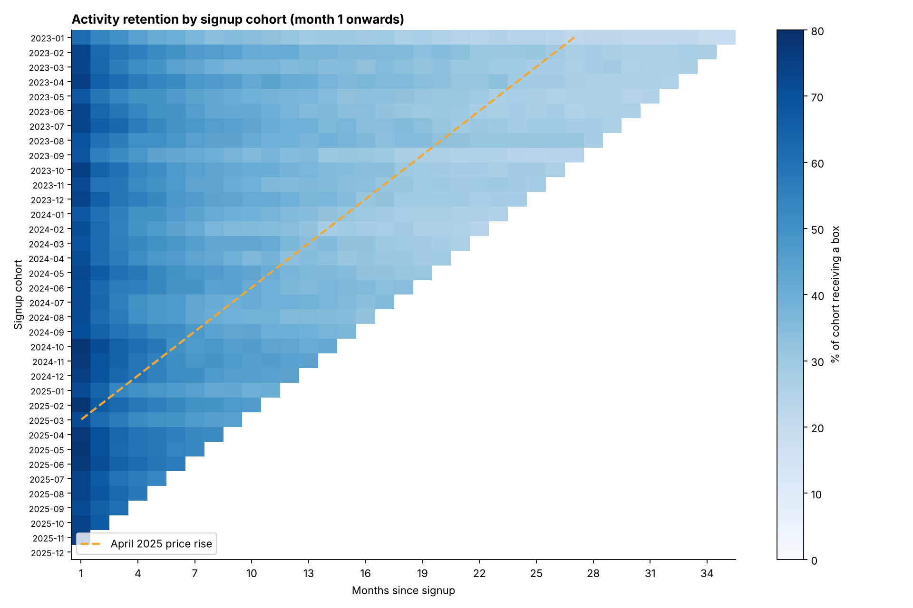

# Cohort Analysis: retention, lifetime value and forecasting for a subscription business

Cohort analysis for **Crate & Co**, a fictional UK meal-kit subscription (synthetic data: 17,818 subscribers,
134,773 boxes, 2023-2025). It answers the questions a subscription business lives by: how long customers stay, what
they are worth, which acquisition channels and offers pay back, what a price rise cost, whether a product change
worked, and how to forecast retention for brand-new cohorts.



## Highlights

* **Cohort tables in pandas and SQL.** The retention matrix is computed both ways, and a test checks that they match
  cell for cell.
* **Unit economics.** Contribution (revenue minus cost of goods, so a free box counts as a cost), CAC by channel,
  LTV:CAC and payback month.
* **Shifted-beta-geometric (sBG) model.** Fitted by maximum likelihood with SciPy. Trained on only 6 months of data,
  it forecasts the next 2 years with **7.2%** error, against **59.9%** for a constant-churn model.
* **Causal care.** The onboarding change is evaluated with a naive before/after comparison *and* a regression that
  controls for customer mix, with the limits of a before/after design stated clearly.
* **Calendar vs cohort effects.** The April 2025 price rise appears as a diagonal in the heatmap; the calendar-churn
  view measures its size.
* **Interactive dashboard** (`outputs/interactive/cohort_dashboard.html`) and an executed walkthrough notebook.

## Key findings

| Finding | Number |
|---|---|
| Still subscribed after 1 / 3 / 12 / 24 months | 77.4% / 62.7% / 40.3% / 29.5% |
| Revenue at month 12 vs month 1 (NRR) | 56.6% (add-ons partly offset churn) |
| Still subscribed after month 1: "first box free" vs no offer | 56.6% vs 85.9% |
| 12-month contribution: "first box free" vs no offer | £37 vs £123 per customer |
| LTV:CAC (12 months): Organic / Referral / Search / Paid social / Influencer | 16.6x / 6.2x / 2.4x / 1.7x / 1.3x |
| Payback: Referral vs Influencer | month 2 vs month 9 |
| Churn of established subscribers in the price-rise month | 9.85% vs typical 4.93% (~293 extra cancellations) |
| New onboarding (Sep 2024): month-3 retention | +5.0 pts naive, +5.3 pts adjusted (OR 1.28, 95% CI 1.18-1.38) |
| sBG forecast error (6 months of training, 30-month horizon) | 7.2% vs 59.9% for constant churn |

**Recommendations:** stop "first box free" (switch to 50% off or no offer), move budget from influencer to referral
and search, pair any future price rise with a retention offer for long-standing customers, keep the new onboarding,
and A/B test the next change instead of relying on before/after comparisons.

Full write-up: [`outputs/results/insights.md`](outputs/results/insights.md).

## Project structure

```
cohort-analysis/
├── src/cohort_analysis/
│   ├── config.py          # dates, gross margin, event dates, colours
│   ├── generate_data.py   # synthetic customers, boxes and marketing spend
│   ├── cohorts.py         # retention matrices, curves, segments, calendar churn
│   ├── ltv.py             # contribution, CAC, LTV:CAC, payback, offer economics
│   ├── sbg.py             # shifted-beta-geometric model: fit, backtest, segment projections
│   ├── experiments.py     # onboarding before/after: two-proportion z-test + logistic regression
│   ├── sql_runner.py      # runs sql/*.sql on an in-memory SQLite copy
│   ├── reporting.py       # CSVs, charts, interactive HTML, insights
│   └── __main__.py        # CLI: data | analyse | all
├── sql/                   # cohort_retention.sql, ltv_by_channel.sql
├── data/raw/              # customers.csv, orders.csv, marketing_spend.csv
├── notebooks/01_cohort_walkthrough.ipynb
├── tests/                 # 16 tests
├── outputs/
│   ├── results/           # matrices, curves, segment tables, summary.json, insights.md
│   ├── figures/           # 9 charts
│   └── interactive/       # cohort_dashboard.html (Plotly)
├── docs/
│   ├── presentation/      # Cohort_Analysis_Presentation.pptx (~25 min, speaker notes)
│   └── report/            # Cohort_Analysis_Final_Report.docx / .pdf
├── scripts/               # run_all.bat / run_all.sh
├── requirements.txt
├── pyproject.toml
├── PROJECT_SUMMARY.md
└── LICENSE
```

## Getting started (VS Code)

```bash
python -m venv .venv
.venv\Scripts\activate          # Windows
# source .venv/bin/activate     # macOS / Linux
pip install -r requirements.txt
pip install -e .

python -m cohort_analysis all   # generate data and run every analysis (~20 seconds)
pytest                          # 16 tests
```

Open `outputs/interactive/cohort_dashboard.html` in a browser (it loads Plotly from a CDN, so it needs internet),
or run the notebook.

## Definitions

* **Cohort:** customers who signed up in the same calendar month. **Age:** months since signup (signup month = 0).
* **Activity retention:** % of the cohort that received a box at age N (paused months count as inactive).
* **Subscription survival:** % of the cohort that had not cancelled by age N.
* **Net revenue retention (NRR):** revenue at age N as % of revenue at age 1 (age 0 is distorted by first-box discounts).
* **Contribution:** box + add-on revenue − 65% × (box list price + add-ons). A free box therefore has negative contribution.
* **CAC:** marketing spend ÷ new customers, by channel. **LTV:CAC:** 12-month contribution ÷ CAC.
* **Payback month:** first age at which cumulative contribution per customer exceeds CAC.
* Averages across cohorts are weighted by cohort size and use only cohorts that have reached that age.

## The sBG model in one paragraph

Each customer has their own monthly probability of cancelling, *p*, and *p* varies across customers following a
Beta(*a*, *b*) distribution. Risky customers leave early, so the remaining customers are increasingly loyal and the
curve flattens, which a single constant churn rate cannot reproduce. Survival is S(t) = B(a, b + t) / B(a, b), and
*a* and *b* are estimated by maximum likelihood from cancellations and still-active (censored) customers
(Fader & Hardie, 2007). A test confirms the fitting code recovers known parameters from simulated data.

## Data

All data is **synthetic** (fixed seed, reproducible). Effects were built in on purpose so the methods can be
checked against a known truth: heterogeneous churn, the free-box cliff, channel differences, the onboarding
improvement, the price-rise spike and add-on expansion.

## Author

**Mohamed Moin Peer**, MSc Data Analytics, Queen's University Belfast. [GitHub](https://github.com/MOIN-PEER) · MIT Licence
